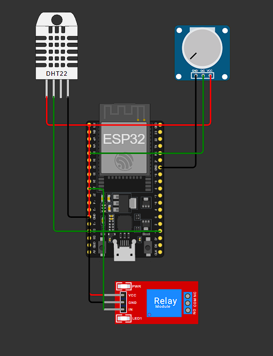

# IyaSense


**IoT plant monitoring and automated irrigation with ESP32, MQTT, and C#/.NET WPF.**

IyaSense is an in-development IoT project combining an ESP32-based irrigation controller with a Windows desktop dashboard. The controller reads environmental data, applies local watering rules, and publishes telemetry over MQTT. The WPF application displays live readings and sends commands to switch operating modes or control irrigation manually.

**Current status:** Functional simulator-based prototype. The core monitoring and irrigation flows have passed manual functional checks in Wokwi and WPF. UI polish and release packaging remain. No physical pump or soil sensor has been validated. See [Testing](docs/TESTING.md) for the test matrix, evidence, and limitations.

## Features

- Live temperature and air-humidity monitoring using a simulated DHT22 sensor.
- Simulated soil-moisture monitoring via an analog potentiometer.
- Automatic irrigation when soil moisture falls below 30%.
- Five-second irrigation run limit and 30-second cooldown between runs under normal operation.
- Automatic and manual modes, with commands sent from the WPF dashboard.
- Manual pump start/stop and live pump-state feedback.
- Cooldown status displayed in the desktop app.
- MQTT telemetry and command channels, with reconnect attempts on the ESP32.
- Device Online/Offline detection using telemetry freshness; unavailable-device controls are disabled.
- WPF Connect/Disconnect control and MQTT disconnect handling.

## Architecture

```text
                 MQTT broker (public HiveMQ test broker)
                  /                            \
      telemetry  /                              \  commands
                v                                v
       WPF desktop app                      ESP32 controller
       C# / .NET / MVVM                      Arduino / C++
       - live readings                      - DHT22 readings
       - mode and pump status               - analog soil input
       - control commands                   - irrigation rules
                                            - relay output
```

The **ESP32 owns the irrigation decisions and run timers**. The desktop application sends requests and displays telemetry reported by the controller; it does not directly drive the relay.

| MQTT topic | Direction | Purpose |
| --- | --- | --- |
| `growcare/my-id-12345/telemetry` | ESP32 → WPF | Sensor readings, pump state, mode, cooldown |
| `growcare/my-id-12345/commands` | WPF → ESP32 | `MODE_AUTO`, `MODE_MANUAL`, `PUMP_START`, `PUMP_STOP` |

## Hardware simulation

The current setup runs in **Wokwi** and includes an ESP32, DHT22, potentiometer (simulated soil moisture), and relay module (simulated pump control).



The Wokwi source files are available in [`firmware/wokwi/`](firmware/wokwi/):

- `sketch.ino` - firmware and irrigation logic
- `diagram.json` - circuit wiring and components
- `libraries.txt` - simulation dependencies

## Getting started

### 1. Run the ESP32 simulation

1. Open [Wokwi](https://wokwi.com/) and create an ESP32 Arduino project.
2. Copy the repository's `firmware/wokwi/sketch.ino`, `diagram.json`, and `libraries.txt` into the corresponding Wokwi project files.
3. Start the simulation and check the Serial Monitor for Wi-Fi/MQTT connection and published telemetry.
4. Adjust the potentiometer to simulate a change in soil moisture.

### 2. Run the Windows application

1. On **Windows**, install the **.NET 10 SDK** and a compatible version of Visual Studio with the **.NET desktop development** workload.
2. Clone the repository and open its solution in Visual Studio.
3. Restore NuGet packages and run `IyaSense.App`.
4. Select **Connect** to subscribe to live telemetry.
5. Use the mode switch to select **Manual** before testing the pump control button.

Both components currently use the public HiveMQ broker at `broker.hivemq.com:1883`. The topic prefix and ESP32 client ID are hardcoded for demonstration purposes; change them if running your own instance to avoid collisions with other users of the public broker.

## Testing

Core irrigation and connection-management workflows were **manually tested** in Wokwi and the WPF desktop application. See **[docs/TESTING.md](docs/TESTING.md)** for scenarios, observed results, sample serial logs, and known gaps. The green badge above indicates *manual functional checks passed*, **not** an automated CI test suite or physical hardware validation.

## Tech stack

| Component | Technologies |
| --- | --- |
| Desktop | C#, .NET 10, WPF, MVVM, MQTTnet, System.Text.Json |
| Firmware | ESP32, Arduino/C++, PubSubClient, ArduinoJson, DHTesp |
| Simulation | Wokwi |
| Messaging | MQTT (HiveMQ public test broker) |

## Limitations and next steps

- **Simulation only:** the pump is represented by a relay; operation with physical irrigation hardware has not been tested.
- **Safety:** network operations can still block parts of the controller loop. The five-second run limit is not a hard real-time or hardware safety guarantee. Do not connect a real pump without independent fail-safe protection and additional testing.
- **Connection handling:** unexpected network loss, prolonged TCP stalls, and command rejection feedback are not fully covered; see the test report.
- **UI and release:** final interface polish and demonstration materials are pending.

## Project status

**In development — core simulation functionality manually tested; UI and release polish remaining.**
