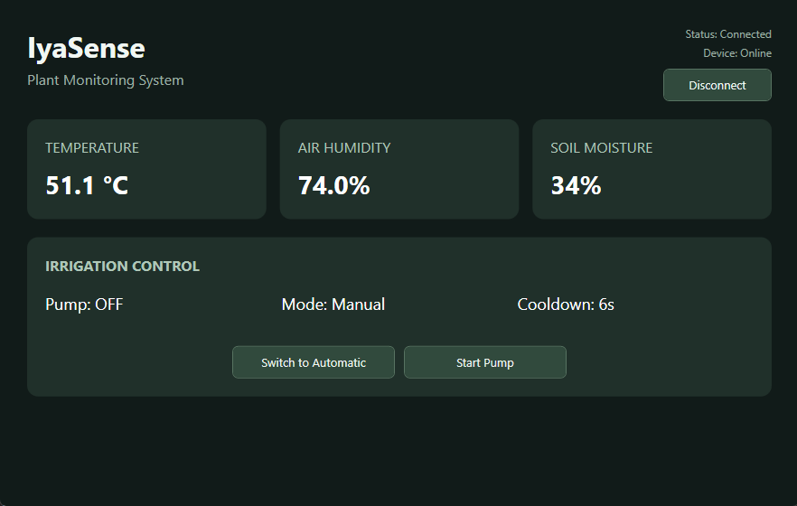

# IyaSense


**IoT plant monitoring and automated irrigation with ESP32, MQTT, and C#/.NET WPF.**

IyaSense is a simulator-based IoT plant monitoring and automated irrigation system combining an ESP32 controller with a Windows desktop application built using C#/.NET and WPF.

The ESP32 collects environmental data, independently manages irrigation, and communicates with the desktop application over MQTT. The WPF dashboard provides live sensor readings, automatic/manual mode switching, pump control, and device connectivity monitoring.

Current status: The core functionality is implemented and has passed manual end-to-end testing in Wokwi and WPF. The project is being prepared for its first release, v0.1.0. Physical irrigation hardware has not been tested.

## Desktop Dashboard



The WPF dashboard provides live sensor monitoring, irrigation mode switching, manual pump control, and cooldown tracking.

## Features

- Live temperature and air-humidity monitoring using a simulated DHT22 sensor.
- Simulated soil-moisture monitoring via an analog potentiometer.
- Automatic irrigation when soil moisture falls below 30%.
- Five-second irrigation run limit and 30-second cooldown between runs under normal operation.
- Automatic and manual modes, with commands sent from the WPF dashboard.
- Manual pump start/stop and live pump-state feedback.
- Cooldown status displayed in the desktop app.
- MQTT telemetry and command channels, with reconnect attempts on the ESP32.
- Device Online/Offline detection using telemetry freshness; unavailable-device controls are disabled.
- Incoming telemetry validation before updating device state.
- MQTT command error handling with feedback in the desktop dashboard.
- MQTT connection management with device availability tracking and disabled controls when offline.

## Architecture

```text
                 MQTT broker (public HiveMQ test broker)
                  /                            \
      telemetry  /                              \  commands
                v                                v
       WPF desktop app                      ESP32 controller
       C# / .NET / MVVM                      Arduino / C++
       - live readings                      - DHT22 readings
       - mode and pump status               - analog soil input
       - control commands                   - irrigation rules
                                            - relay output
```

The **ESP32 owns the irrigation decisions and run timers**. The desktop application sends requests and displays telemetry reported by the controller; it does not directly drive the relay.

| MQTT topic | Direction | Purpose |
| --- | --- | --- |
| `<topic-prefix>/telemetry` | ESP32 → WPF | Sensor readings, pump state, mode, cooldown |
| `<topic-prefix>/commands` | WPF → ESP32 | `MODE_AUTO`, `MODE_MANUAL`, `PUMP_START`, `PUMP_STOP` |

The topic prefix is configured in both the ESP32 firmware and the WPF MQTT service. Both components must use matching topics.

## Hardware simulation

The current setup runs in **Wokwi** and includes an ESP32, DHT22, potentiometer (simulated soil moisture), and relay module (simulated pump control).


The Wokwi source files are available in [`firmware/wokwi/`](firmware/wokwi/):

- `sketch.ino` - firmware and irrigation logic
- `diagram.json` - circuit wiring and components
- `libraries.txt` - simulation dependencies

## Getting started

### 1. Run the ESP32 simulation

1. Open [Wokwi](https://wokwi.com/) and create an ESP32 Arduino project.
2. Copy the repository's `firmware/wokwi/sketch.ino`, `diagram.json`, and `libraries.txt` into the corresponding Wokwi project files.
3. Start the simulation and check the Serial Monitor for Wi-Fi/MQTT connection and published telemetry.
4. Adjust the potentiometer to simulate a change in soil moisture.

### 2. Run the Windows application

1. On **Windows**, install the **.NET 10 SDK** and a compatible version of Visual Studio with the **.NET desktop development** workload.
2. Clone the repository and open its solution in Visual Studio.
3. Restore NuGet packages and run `IyaSense.App`.
4. Select **Connect** to subscribe to live telemetry.
5. Use the mode switch to select **Manual** before testing the pump control button.

Both components currently use the public HiveMQ broker at `broker.hivemq.com:1883`. The topic prefix and ESP32 client ID are hardcoded for demonstration purposes; change them if running your own instance to avoid collisions with other users of the public broker.

> **Note:** The default MQTT broker is a public test service. Use a unique topic prefix and ESP32 client ID when running your own instance. The current MQTT setup does not provide authentication or encrypted transport.

## Testing

Core irrigation and connection-management workflows were **manually tested** in Wokwi and the WPF desktop application. See **[docs/TESTING.md](docs/TESTING.md)** for scenarios, observed results, sample serial logs, and known gaps. The green badge above indicates *manual functional checks passed*, **not** an automated CI test suite or physical hardware validation.

## Tech stack

| Component | Technologies |
| --- | --- |
| Desktop | C#, .NET 10, WPF, MVVM, MQTTnet, System.Text.Json |
| Firmware | ESP32, Arduino/C++, PubSubClient, ArduinoJson, DHTesp |
| Simulation | Wokwi |
| Messaging | MQTT (HiveMQ public test broker) |

## Known limitations

- **Simulation only:** The project has been tested using virtual ESP32 components in Wokwi. No physical irrigation hardware has been validated.
- **Safety:** The five-second pump limit is software-controlled and does not provide a hard real-time guarantee. Network operations may block execution. Physical deployment requires independent fail-safe protection.
- **Connectivity:** Unexpected network failures and prolonged TCP stalls have not been exhaustively tested.
- **MQTT:** The public test broker does not provide authenticated or encrypted communication in the current configuration. Commands may be rejected by the controller during cooldown without a dedicated rejection notification in the dashboard.

See [Testing](docs/TESTING.md) for detailed test results and remaining verification gaps.

## Project status

**v0.1.0 — initial simulator-based MVP release.**

Core functionality has passed manual end-to-end testing. The desktop dashboard, automated irrigation logic, manual pump control, cooldown handling, and device connectivity monitoring are implemented.

The project is intended as a software engineering and IoT portfolio demonstration, not a production-ready physical irrigation controller.
